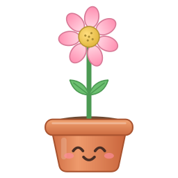
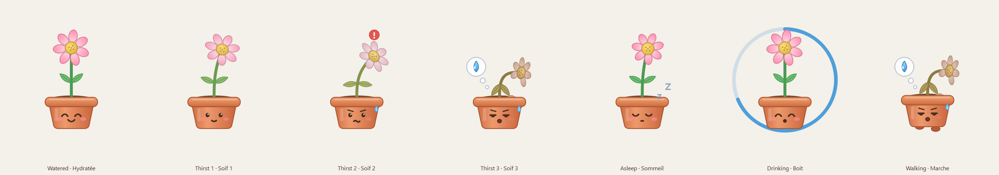
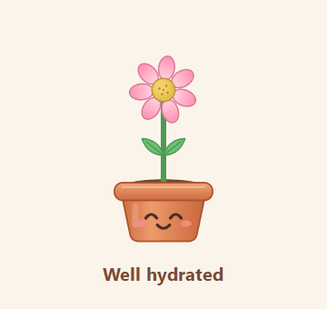

<p align="center">
  
</p>

<h1 align="center">Petite Soif</h1>

<p align="center">
  Une petite fleur en pot qui vit sur ton bureau Windows… et qui a soif quand tu oublies de boire.<br>
  Pense à l'hydrater quand tu t'hydrates.<br>
  Tu bois une gorgée, tu l'arroses d'un clic. Si tu l'oublies, elle se dessèche… et vient te le rappeler, de plus en plus fort.
</p>

<p align="center">
  
</p>

<p align="center">
  
</p>

## Pourquoi

Un besoin perso : depuis toujours, je ne bois pas assez d'eau. Je n'aime pas son goût.
Pendant longtemps, j'ai compensé avec des sodas, ce qui n'est pas génial pour le corps.
J'ai trouvé quelques alternatives (du citron, des sirops sans sucre), mais il me fallait surtout
un moyen de boire de l'eau malgré tout.

J'ai repensé au Tamagotchi de mon enfance. Si une petite plante mignonne me rouspétait dessus,
est-ce que j'aurais envie de boire plus ? Si on me rappelait toutes les X minutes de boire,
est-ce que je le ferais ? Ça valait le coup d'essayer. Alors j'ai fait Petite Soif.

## Installation

1. Va dans **[Releases](../../releases/latest)** et télécharge `PetiteSoif-vX.Y.Z-windows.zip`.
2. Fais un clic droit sur le zip → **Extraire tout…**, dans un dossier qui te va (par exemple `Documents\PetiteSoif`).
3. Lance **`PetiteSoif.exe`**.

> **Windows affiche « Windows a protégé votre ordinateur » ?**
> C'est normal pour un petit programme gratuit qui n'a pas de certificat de signature payant.
> Clique sur **Informations complémentaires** → **Exécuter quand même**.
> Le code est entièrement public dans ce repo, et l'exe est construit automatiquement par GitHub
> à partir de ce code ([voir les builds](../../actions)). L'empreinte SHA-256 de chaque zip est
> publiée avec la release si tu veux vérifier ton téléchargement.

Au premier lancement, la fleur te demande si elle doit démarrer avec Windows.

## Utilisation

| Geste | Effet |
|---|---|
| **Clic gauche maintenu** (sans bouger) | « J'ai bu une gorgée » : glouglou, étoiles, le compteur de soif repart de zéro |
| **Clic droit** | Ta journée : total bu, objectif, bouton **+ 50 cl** quand tu finis ton verre, 7 derniers jours |
| **Shift + clic maintenu** | Déplacer la fleur |
| **Ctrl + Alt + F1** | Ramener la fleur sur l'écran principal si elle s'est perdue |
| **Icône près de l'horloge** | Ne pas déranger, export CSV, réglages, démarrage auto, quitter |

### Les rappels

| Sans boire depuis… | La fleur… |
|---|---|
| 20 min | fait un petit son |
| 30 min | se plaint et s'agite |
| 40 min | court après ta souris pendant 5 s |
| ensuite | recommence chaque minute, **seulement si tu es devant l'ordinateur** |

Si tu t'absentes alors qu'elle a très soif, elle t'attend à côté du curseur et te suit dès ton retour.
La journée repart à zéro à **6 h du matin**. Le mode **Ne pas déranger** (30 min, 1 h, 2 h ou jusqu'au lendemain) l'endort.

Tous les délais se règlent dans `config.json` (menu de l'icône → *Ouvrir config.json*, puis *Recharger la configuration*).

## Vie privée

- **Rien ne quitte ton ordinateur.** Petite Soif ne se connecte jamais à internet : pas de compte, pas de statistiques, pas de publicité.
- Ton historique (heures de chaque gorgée et de chaque verre) est stocké uniquement sur ton PC, dans `%APPDATA%\PetiteSoif\`.
- Pour savoir si tu es devant l'ordinateur, l'appli demande seulement à Windows **depuis combien de temps** il n'y a pas eu d'activité clavier/souris. Elle ne lit **jamais** ce que tu tapes.

## Désinstaller

1. Icône près de l'horloge → décoche **Lancer au démarrage de Windows**, puis **Quitter**.
2. Supprime le dossier où tu as extrait l'application.
3. (Optionnel) Supprime tes données : tape `%APPDATA%\PetiteSoif` dans la barre d'adresse de l'explorateur et supprime le dossier.

## Fait avec Claude

J'ai conçu l'application (besoin, comportements, règles, interface) et le code a été entièrement écrit par Claude à partir de mes demandes.

## Un souci, une idée ?

Une idée ou une envie ? Passe dans les [Discussions](../../discussions).

Un bug ? Ouvre une [issue](../../issues) : décris ce qui s'est passé et, si possible, joins le fichier
`%APPDATA%\PetiteSoif\donnees\erreurs.log`. Pense à relire ce fichier avant de le partager :
il peut contenir ton nom d'utilisateur Windows dans des chemins de dossiers.

## Tu souhaites me remercier ?

Je suis ravi que Petite Soif te plaise ! Tu peux mettre une ⭐ au projet (en haut de cette page)
ou me laisser un petit mot dans les [Discussions](../../discussions), même juste pour dire que ça t'a aidé :
ça me fera très plaisir.

Et surtout : sois un humain cool avec les gens autour de toi, et répands de l'amour et de la bienveillance.
C'est la meilleure façon de me remercier.

## Pour les développeurs

```bat
:: Lancer depuis le code (Python 3.10+)
py -m pip install -r requirements.txt
pyw petite_soif.pyw

:: Construire l'exe localement (résultat dans dist\PetiteSoif\)
build.bat
```

Une release se publie en poussant un tag : `git tag v1.0.1 && git push origin v1.0.1`.
Le workflow `.github/workflows/release.yml` construit l'exe sur Windows et l'attache à la release.

## Licence

Code sous licence [MIT](LICENSE). L'exe embarque Qt/PySide6 (LGPL-3.0) et Python (PSF) : voir [THIRD_PARTY_NOTICES.md](THIRD_PARTY_NOTICES.md).
