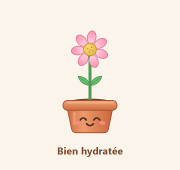

<p align="center">
  
</p>

<h1 align="center">Petite Soif</h1>

<p align="center">
  <b>English</b> · <a href="#petite-soif-français">Français</a>
</p>

<p align="center">
  A little potted flower that lives on your Windows desktop… and gets thirsty when you forget to drink.<br>
  Water her when you water yourself.<br>
  Take a sip, water her with a click. Forget, and she dries up… then comes to remind you, louder and louder.
</p>

<p align="center">
  
</p>

<p align="center">
  
</p>

## What's new in V2

- **A real settings window** (hover the pot → ⚙) with far more settings than before: reminders, hydration goal, flower size, sound volume, shortcut, and an **FR | EN** language switch.
- **My plant**: every sip earns XP, and XP unlocks new plants to put in your pot. Ten to discover, each with its own way of getting
  thirsty and of falling asleep: no spoilers here. Prefer to skip XP? An "Unlock everything" switch turns it off.
- **Insistence**: *Gentle*, *Normal* or *Pushy* reminders.
- **Do not disturb in one click**: 💤 on the pot or in the pop-up (30 min), 🔔 to wake her up.
- A redesigned right-click pop-up, softer sounds, tray and taskbar icons that follow your plant, and a **Report a bug** link that is easy to find.

**Coming from V1?** Your settings and history are kept (see [Updating](#install)).

All the details are in the [changelog](CHANGELOG.md).

## Why

A personal need: I have never drunk enough water. I don't like the taste.
For a long time I made up for it with sodas, which isn't great for the body.
I found a few alternatives (lemon, sugar-free syrups), but above all I needed
a way to drink water anyway.

I thought back to the Tamagotchi of my childhood. If a cute little plant grumbled at me,
would I want to drink more? If something reminded me every X minutes,
would I do it? It was worth a try. So I made Petite Soif ("little thirst" in French).

## Install

1. Go to **[Releases](../../releases/latest)** and download `PetiteSoif-vX.Y.Z-windows.zip`.
2. Right-click the zip → **Extract All…** into a folder of your choice (for example `Documents\PetiteSoif`).
3. Run **`PetiteSoif.exe`**.

> **Windows says "Windows protected your PC"?**
> That's normal for a small free program without a paid code-signing certificate.
> Click **More info** → **Run anyway**.
> All the code is public in this repo, and the exe is built automatically by GitHub
> from that code ([see the builds](../../actions)). The SHA-256 of each zip is
> published with the release if you want to check your download.

On first launch, the flower asks whether she should start with Windows.

**Updating:** there is no automatic update (the app never connects to the internet). Settings → About → **Check for updates** opens the Releases page: download the new zip, quit the old version from the tray icon, extract the new one and run it. Your settings and history are kept.

## How to use

| Gesture | Effect |
|---|---|
| **Long left click** (without moving) | "I took a sip": gulp, stars, +XP, the thirst timer starts over |
| **Right click** | Your day: total drunk, goal, **+ 50 cl** button when you finish a glass, last 7 days |
| **Shift + long click** | Move the flower |
| **Hover the pot → ⚙ / 💤** | Settings / Do not disturb for 30 min (🔔 wakes her up) |
| **Ctrl + Alt + F1** | Bring the flower back to the main screen if she got lost (shortcut can be changed) |
| **Tray icon** | Do not disturb (other durations), settings, CSV export, quit |

### Reminders

These are the default delays. You can change them in **Settings → Reminders**.

| Without drinking for… | The flower… |
|---|---|
| 20 min | makes a little sound |
| 30 min | complains and fidgets |
| 40 min | chases your mouse for 5 s |
| after that | starts again every minute, **only if you're at the computer** |

If you step away while she's very thirsty, she waits next to your cursor and follows you when you come back.
By default, the day resets at **6 am** (**Settings → Hydration**). **Do not disturb** (30 min, 1 h, 2 h or until the next day) puts her to sleep.

### Settings

Everything is set from the settings window and applied right away: reminder delays, insistence
(**Gentle**, **Normal** or **Pushy**, which circles around your cursor), daily goal, glass size, flower size,
volume, shortcut, start with Windows, and the **FR | EN** language switch at the bottom left.
Finer settings stay available in `config.json` (Settings → System → Advanced settings).

### My plant

Each sip earns XP: **+5** for the first sip of the day, **+1** per sip, **+3** per glass, and a little "+XP" floats up from the flower.
Every 200 XP unlocks a new plant, and a "New plant!" label stays above the flower until you go and see it. There are ten to discover, each with its own way of
getting thirsty and of falling asleep (yes, it shows when you switch on Do not disturb too), so the next one stays a "?" on the shelf until
you earn it. Open **Settings → My plant** to see your shelf, your level and the XP bar, and click an unlocked plant to put it in the pot.
A red dot on the pop-up gear and on the tab also tells you when there's something new.

Your XP is simply computed from your local history: nothing extra is stored, and it never leaves your PC.

Play fair: only click when you really drink. Prefer to skip XP? **Unlock everything** (at the bottom of **My plant**, with a
confirmation) turns XP off and makes every plant available. You can switch it back any time, your XP is never lost.

## Privacy

- **Nothing leaves your computer.** Petite Soif never connects to the internet: no account, no analytics, no ads.
- Your history (time of each sip and each glass) is stored only on your PC, in `%APPDATA%\PetiteSoif\`.
- To know whether you're at the computer, the app only asks Windows **how long** it has been since the last
  keyboard/mouse activity. It **never** reads what you type.

## Uninstall

1. Settings → System → turn off **Start with Windows**, then tray icon → **Quit**.
2. Delete the folder where you extracted the app.
3. (Optional) Delete your data: type `%APPDATA%\PetiteSoif` in the File Explorer address bar and delete the folder.

## Made with Claude

I designed the app (need, behaviours, rules, interface) and the code was written entirely by Claude from my requests.
The designs, unfortunately, were created by Claude too: I couldn't afford to pay a graphic designer for this.

## A problem, an idea?

An idea or a wish? Drop by the [Discussions](../../discussions).

A bug? Click **🐞 Report a bug** at the bottom left of the settings window (or in the tray menu): it opens a pre-filled [issue form](../../issues) with your app and Windows
versions. If you can, attach `%APPDATA%\PetiteSoif\donnees\erreurs.log` (Settings → About → Error log).
Read it before sharing: it may contain your Windows user name in folder paths.

## Want to say thanks?

I'm glad you like Petite Soif! You can star the project (⭐ at the top of this page)
or leave me a note in the [Discussions](../../discussions), even just to say it helped: that would make my day.

And above all: be a cool human with the people around you, and spread love and kindness.
That's the best way to thank me.

## For developers

```bat
:: Run from source (Python 3.10 to 3.14)
py -m pip install -r requirements.txt
pyw petite_soif.pyw

:: Run the tests (Qt offscreen, temporary data folder)
py -m unittest discover -s tests -t .

:: Build the exe locally (output in dist\PetiteSoif\)
build.bat
```

A release is published by pushing a tag: `git tag v2.0.1 && git push origin v2.0.1`.
The `.github/workflows/release.yml` workflow builds the exe on Windows, zips it with its SHA-256 and publishes the release,
with notes taken from `CHANGELOG.md` (add a `## 2.0.1` section before tagging, otherwise the workflow stops).

## Licence

Code under the [MIT](LICENSE) licence. The exe bundles Qt/PySide6 (LGPL-3.0), Python (PSF) and the Baloo 2 font
(OFL-1.1): see [THIRD_PARTY_NOTICES.md](THIRD_PARTY_NOTICES.md).

---

# Petite Soif (français)

<p align="center">
  Une petite fleur en pot qui vit sur ton bureau Windows… et qui a soif quand tu oublies de boire.<br>
  Pense à l'hydrater quand tu t'hydrates.<br>
  Tu bois une gorgée, tu l'arroses d'un clic. Si tu l'oublies, elle se dessèche… et vient te le rappeler, de plus en plus fort.
</p>

<p align="center">
  
</p>

## Nouveautés de la V2

- **Une vraie fenêtre de paramètres** (survol du pot → ⚙), avec bien plus de réglages qu'avant : rappels, objectif d'hydratation, taille de la fleur, volume du son, raccourci, et le choix de langue **FR | EN**.
- **Ma plante** : chaque gorgée rapporte de l'XP, et l'XP débloque de nouvelles plantes à mettre dans ton pot. Dix à découvrir, chacune avec sa
  façon d'avoir soif et de s'endormir : on ne dit rien de plus. Tu préfères t'en passer ? Un interrupteur « Tout débloquer » coupe l'XP.
- **Insistance** : rappels *Doux*, *Normaux* ou *Tenaces*.
- **Ne pas déranger en un clic** : 💤 sur le pot ou dans la pop-up (30 min), 🔔 pour la réveiller.
- Une pop-up de clic droit refaite, des sons plus doux, des icônes (près de l'horloge et barre des tâches) qui suivent ta plante, et un lien **Signaler un bug** facile à trouver.

**Tu viens de la V1 ?** Tes réglages et ton historique sont conservés (voir [Mettre à jour](#installation)).

Tous les détails sont dans le [changelog](CHANGELOG.md).

## Pourquoi

Un besoin perso : depuis toujours, je ne bois pas assez d'eau. Je n'aime pas son goût.
Pendant longtemps, j'ai compensé avec des sodas, ce qui n'est pas génial pour le corps.
J'ai trouvé quelques alternatives (du citron, des sirops sans sucre), mais il me fallait surtout
un moyen de boire de l'eau malgré tout.

J'ai repensé au Tamagotchi de mon enfance. Si une petite plante mignonne me rouspétait dessus,
est-ce que j'aurais envie de boire plus ? Si on me rappelait toutes les X minutes de boire,
est-ce que je le ferais ? Ça valait le coup d'essayer. Alors j'ai fait Petite Soif.

## Installation

1. Va dans **[Releases](../../releases/latest)** et télécharge `PetiteSoif-vX.Y.Z-windows.zip`.
2. Fais un clic droit sur le zip → **Extraire tout…**, dans un dossier qui te va (par exemple `Documents\PetiteSoif`).
3. Lance **`PetiteSoif.exe`**.

> **Windows affiche « Windows a protégé votre ordinateur » ?**
> C'est normal pour un petit programme gratuit qui n'a pas de certificat de signature payant.
> Clique sur **Informations complémentaires** → **Exécuter quand même**.
> Le code est entièrement public dans ce repo, et l'exe est construit automatiquement par GitHub
> à partir de ce code ([voir les builds](../../actions)). L'empreinte SHA-256 de chaque zip est
> publiée avec la release si tu veux vérifier ton téléchargement.

Au premier lancement, la fleur te demande si elle doit démarrer avec Windows.

**Mettre à jour :** il n'y a pas de mise à jour automatique (l'appli ne se connecte jamais à internet). Paramètres → À propos → **Vérifier les mises à jour** ouvre la page des Releases : télécharge le nouveau zip, quitte l'ancienne version depuis l'icône près de l'horloge, extrais la nouvelle et lance-la. Tes réglages et ton historique sont conservés.

## Utilisation

| Geste | Effet |
|---|---|
| **Clic gauche maintenu** (sans bouger) | « J'ai bu une gorgée » : glouglou, étoiles, +XP, le compteur de soif repart de zéro |
| **Clic droit** | Ta journée : total bu, objectif, bouton **+ 50 cl** quand tu finis ton verre, 7 derniers jours |
| **Shift + clic maintenu** | Déplacer la fleur |
| **Survol du pot → ⚙ / 💤** | Paramètres / Ne pas déranger 30 min (🔔 la réveille) |
| **Ctrl + Alt + F1** | Ramener la fleur sur l'écran principal si elle s'est perdue (raccourci modifiable) |
| **Icône près de l'horloge** | Ne pas déranger (autres durées), paramètres, export CSV, quitter |

### Les rappels

Voici les délais par défaut. Tu peux les modifier dans **Paramètres → Rappels**.

| Sans boire depuis… | La fleur… |
|---|---|
| 20 min | fait un petit son |
| 30 min | se plaint et s'agite |
| 40 min | court après ta souris pendant 5 s |
| ensuite | recommence chaque minute, **seulement si tu es devant l'ordinateur** |

Si tu t'absentes alors qu'elle a très soif, elle t'attend à côté du curseur et te suit dès ton retour.
Par défaut, la journée repart à zéro à **6 h du matin** (**Paramètres → Hydratation**). Le mode **Ne pas déranger** (30 min, 1 h, 2 h ou jusqu'au lendemain) l'endort.

### Paramètres

Tout se règle dans la fenêtre de paramètres et s'applique tout de suite : délais des rappels, insistance
(**Douce**, **Normale** ou **Tenace**, qui tourne autour de ton curseur), objectif du jour, taille du verre,
taille de la fleur, volume, raccourci, démarrage avec Windows, et la langue **FR | EN** en bas à gauche.
Les réglages fins restent dans `config.json` (Paramètres → Système → Réglages avancés).

### Ma plante

Chaque gorgée rapporte de l'XP : **+5** pour la première gorgée du jour, **+1** par gorgée, **+3** par verre, et un petit « +XP » s'élève de la fleur.
Tous les 200 XP, une nouvelle plante se débloque, et une étiquette « Nouvelle plante ! » reste affichée au-dessus de la fleur jusqu'à ce que tu ailles la voir. Il y en a dix à découvrir, chacune
avec sa façon d'avoir soif et de s'endormir (ça se voit aussi quand tu actives Ne pas déranger) : la suivante reste un « ? » sur l'étagère tant que
tu ne l'as pas gagnée. Ouvre **Paramètres → Ma plante** pour voir ton étagère, ton niveau et la barre d'XP, et clique sur une plante débloquée pour
la mettre dans le pot. Une pastille rouge sur l'engrenage de la pop-up et sur l'onglet te prévient aussi quand il y a du nouveau.

Ton XP est simplement calculé à partir de ton historique local : rien de plus n'est stocké, et rien ne quitte ton PC.

Joue le jeu : clique seulement quand tu bois vraiment. Tu préfères t'en passer ? **Tout débloquer** (en bas de **Ma plante**, avec une confirmation)
coupe l'XP et rend toutes les plantes disponibles. Tu peux le désactiver quand tu veux, ton XP n'est jamais perdu.

## Vie privée

- **Rien ne quitte ton ordinateur.** Petite Soif ne se connecte jamais à internet : pas de compte, pas de statistiques, pas de publicité.
- Ton historique (heures de chaque gorgée et de chaque verre) est stocké uniquement sur ton PC, dans `%APPDATA%\PetiteSoif\`.
- Pour savoir si tu es devant l'ordinateur, l'appli demande seulement à Windows **depuis combien de temps** il n'y a pas eu d'activité clavier/souris. Elle ne lit **jamais** ce que tu tapes.

## Désinstaller

1. Paramètres → Système → désactive **Lancer au démarrage**, puis icône près de l'horloge → **Quitter**.
2. Supprime le dossier où tu as extrait l'application.
3. (Optionnel) Supprime tes données : tape `%APPDATA%\PetiteSoif` dans la barre d'adresse de l'explorateur et supprime le dossier.

## Fait avec Claude

J'ai conçu l'application (besoin, comportements, règles, interface) et le code a été entièrement écrit par Claude à partir de mes demandes.
Les designs ont malheureusement eux aussi été créés par Claude : je n'avais pas les moyens de m'offrir un graphiste pour ça.

## Un souci, une idée ?

Une idée ou une envie ? Passe dans les [Discussions](../../discussions).

Un bug ? Clique sur **🐞 Signaler un bug** en bas à gauche de la fenêtre de paramètres (ou dans le menu de l'icône) : ça ouvre un [formulaire d'issue](../../issues) prérempli avec ta version
de l'appli et de Windows. Si possible, joins `%APPDATA%\PetiteSoif\donnees\erreurs.log` (Paramètres → À propos →
Journal d'erreurs). Pense à relire ce fichier avant de le partager : il peut contenir ton nom d'utilisateur
Windows dans des chemins de dossiers.

## Tu souhaites me remercier ?

Je suis ravi que Petite Soif te plaise ! Tu peux mettre une ⭐ au projet (en haut de cette page)
ou me laisser un petit mot dans les [Discussions](../../discussions), même juste pour dire que ça t'a aidé :
ça me fera très plaisir.

Et surtout : sois un humain cool avec les gens autour de toi, et répands de l'amour et de la bienveillance.
C'est la meilleure façon de me remercier.

## Pour les développeurs

```bat
:: Lancer depuis le code (Python 3.10 à 3.14)
py -m pip install -r requirements.txt
pyw petite_soif.pyw

:: Lancer les tests (Qt hors écran, dossier de données temporaire)
py -m unittest discover -s tests -t .

:: Construire l'exe localement (résultat dans dist\PetiteSoif\)
build.bat
```

Une release se publie en poussant un tag : `git tag v2.0.1 && git push origin v2.0.1`.
Le workflow `.github/workflows/release.yml` construit l'exe sur Windows, le zippe avec son empreinte SHA-256 et publie la release,
avec des notes tirées de `CHANGELOG.md` (ajoute une section `## 2.0.1` avant de tagger, sinon le workflow s'arrête).

## Licence

Code sous licence [MIT](LICENSE). L'exe embarque Qt/PySide6 (LGPL-3.0), Python (PSF) et la police Baloo 2
(OFL-1.1) : voir [THIRD_PARTY_NOTICES.md](THIRD_PARTY_NOTICES.md).
